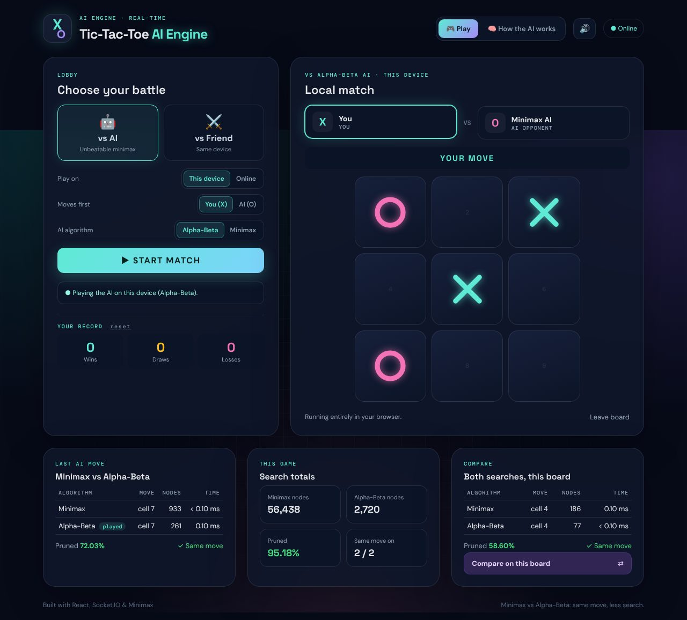
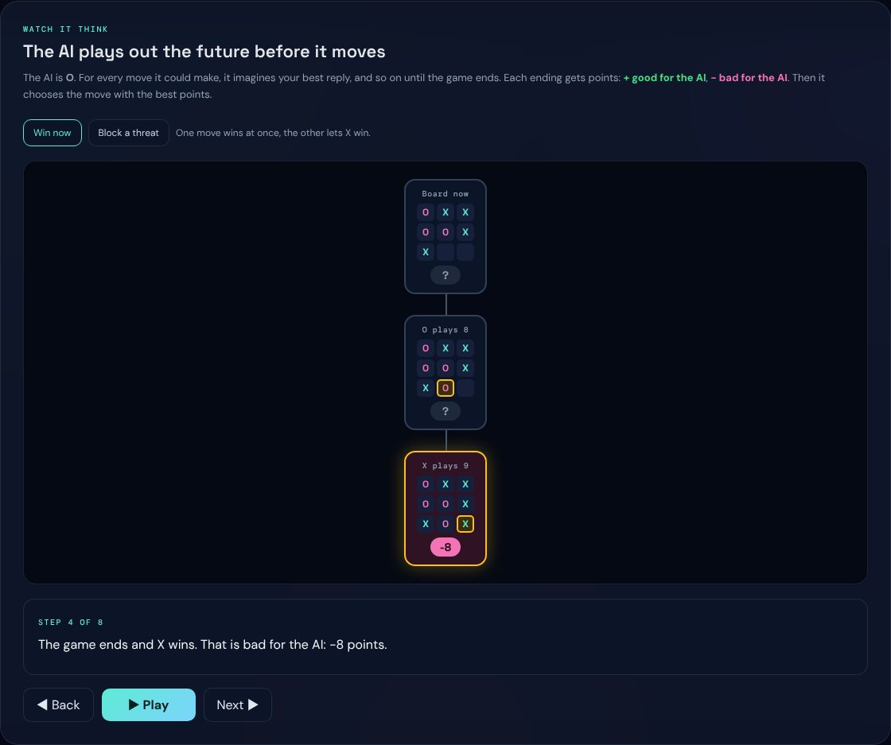
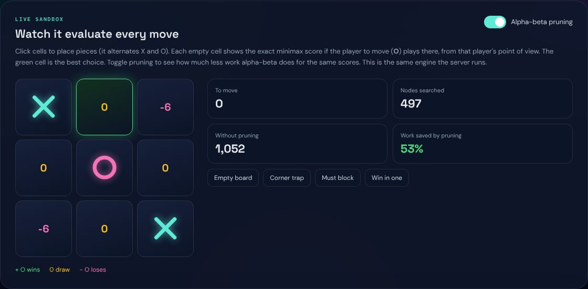
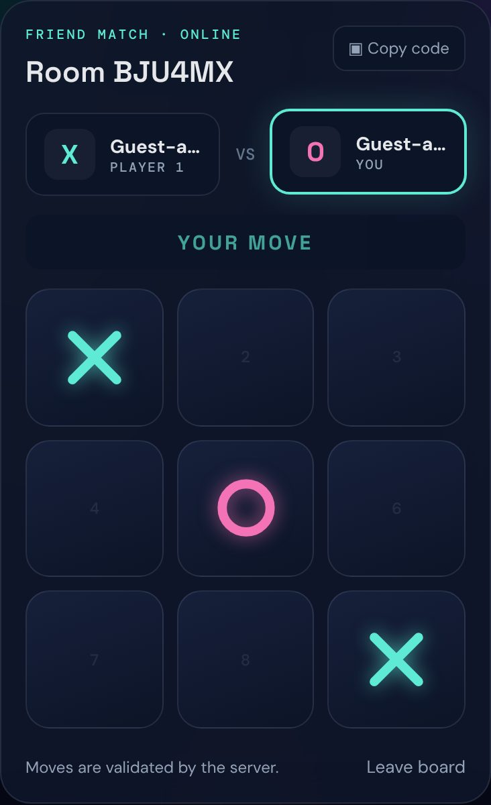

<div align="center">

# Tic-Tac-Toe AI Engine

**Minimax vs Alpha-Beta pruning: same move, a fraction of the search.**

[](https://github.com/amaansiddiqueacademics-a11y/tictactoe-ai-engine/actions/workflows/ci.yml)
[](LICENSE)
[](https://nodejs.org)
[](https://react.dev)
[](https://www.typescriptlang.org)
[](https://socket.io)
[](docker-compose.yml)



</div>

A real-time Tic-Tac-Toe game built around one question: **how much search does Alpha-Beta pruning save over plain Minimax?** Both algorithms always pick the same optimal move; the app plays the game and measures the difference on every AI turn.

It runs three ways from the same code:

- **On this device**: vs the AI or pass-and-play, entirely in the browser. No server needed.
- **Online**: create a room, share the 6-character code, play a friend in real time (React + Socket.IO), or play the AI with moves validated on the server.
- **Algorithm explorer**: an animated minimax walkthrough and a live sandbox that scores every cell, with a pruning toggle.

## Screenshots

| Watch the AI think | Live sandbox with pruning toggle | Online room on a phone |
|---|---|---|
|  |  |  |

## Features

| Area | Details |
|---|---|
| **AI** | Unbeatable Minimax and Minimax with Alpha-Beta pruning. Choose the algorithm and who moves first. |
| **Metrics** | Every AI turn runs *both* searches (the other one is a shadow run). Panels show nodes visited, time, % pruned and whether both picked the same move, plus totals for the game. |
| **Compare** | Runs both searches on the current board for the side to move, without playing a move. |
| **Online rooms** | Guest JWT identity, create/join/reconnect, rematch, leave, opponent away indicator. All moves validated server-side (identity, turn, cell, occupancy, status). |
| **Storage** | Rooms in Redis (shared across server replicas, per-room locks) or in memory when Redis isn't configured. Finished matches in PostgreSQL when configured. |
| **UI** | Sound effects (Web Audio, mutable), confetti, persistent W/D/L record, responsive down to phone width, keyboard and screen-reader labels. |
| **Tests** | 14 engine tests (including the same-move gate over all 4,520 AI-turn boards) and 9 server tests (unit + real Socket.IO end-to-end). |

Reference numbers on the empty board: **Minimax 549,946 nodes, Alpha-Beta 20,866 nodes (96.2% fewer), same move.**

## Project structure

```
tictactoe-ai-engine/
├── shared/                 # Pure game code used by BOTH the server and the browser
│   ├── engine.js           # Rules, scoring, Minimax, Alpha-Beta, measure(), evaluateMoves()
│   ├── match.js            # Match state: create, validate, apply moves, play an AI turn + metrics
│   ├── *.d.ts              # TypeScript types for the client
│   └── test/engine.test.js # Engine gate tests
├── server/                 # Node.js + Express + Socket.IO
│   ├── src/index.js        # Entry: env, Redis/PostgreSQL wiring, shutdown
│   ├── src/app.js          # REST endpoints + Socket.IO events
│   ├── src/store.js        # Room store: Redis or in-memory, with per-room locks
│   ├── src/history.js      # Optional PostgreSQL match history
│   ├── src/schema.sql      # Database schema (applied automatically)
│   ├── test/               # Unit + Socket.IO integration tests (node:test)
│   └── loadtest/           # Connection-capacity smoke test
├── client/                 # React + TypeScript (Vite)
│   └── src/
│       ├── App.tsx         # Lobby, board, local + online play
│       ├── Metrics.tsx     # Last AI move / This game / Compare panels
│       ├── Algorithm.tsx   # "How the AI works" tab and live sandbox
│       └── AlgoAnimation.tsx # Step-by-step minimax tree replay
└── docker-compose.yml      # postgres + redis + server + client (nginx)
```

Because the browser and the server import the same `shared/` files, offline games, online games and the sandbox all play and count nodes identically.

## Quick start (no database needed)

Prerequisite: **Node.js 20+**.

```bash
npm install
npm run dev
```

Open **http://localhost:5173**. The server runs on port 3001 with in-memory rooms; Vite proxies the API and WebSocket, so there is no CORS setup. For online PvP, open a second browser window, choose **Online → vs Friend** in one, and join with the code in the other.

### Single process (production-style)

```bash
npm run build
JWT_SECRET=some-long-random-string NODE_ENV=production npm start
```

The server serves the built client at **http://localhost:3001**.

### With Redis and PostgreSQL

```bash
cp .env.example .env    # uncomment REDIS_URL and DATABASE_URL
npm run dev
```

The match table is created (or upgraded) automatically on startup. `GET /health` reports which storage is in use.

### Docker

```bash
cp .env.example .env    # set JWT_SECRET and POSTGRES_PASSWORD
docker compose up --build
```

Frontend at **http://localhost:8080** (nginx proxies `/api` and `/socket.io` to the server), API at http://localhost:3001.

## Scripts

| Command | What it does |
|---|---|
| `npm run dev` | Server (`node --watch`) and client (Vite) together |
| `npm test` | Engine tests, then server tests |
| `npm run build` | Type-check and build the client, syntax-check the server |
| `npm start` | Start the server (serves `client/dist` if built) |
| `npm run loadtest` | 100-client connection smoke test against a running server |

## How the algorithms differ

- **Minimax** explores the whole game tree. It assumes the opponent always plays its best reply and scores endings as `10 − depth` (win), `depth − 10` (loss) or `0` (draw), so it prefers fast wins and slow losses.
- **Alpha-Beta** returns the same move but skips branches that cannot change the decision (`alpha ≥ beta`). Root alpha is raised after each child and ties keep the earlier cell, so it picks exactly the same cell as Minimax on every reachable board (checked by the tests).
- A **node** is one entry into the search, counting the root and terminal positions.

## Online API

| Method | Path | Description |
|---|---|---|
| `POST` | `/api/guest` | Signed guest JWT + identity |
| `GET` | `/api/matches?limit=N` | Last N finished matches (503 if history is disabled) |
| `GET` | `/health` | Storage status |

Socket.IO events (client → server, each acknowledged with `{ ok, game?, error? }`): `room:create { mode, algo, aiFirst }`, `room:join { roomCode }`, `room:reconnect { roomCode }`, `room:leave { roomCode }`, `game:move { roomCode, cell }`, `game:rematch { roomCode }`. The server broadcasts `game:state` with the full game, including `lastAi` and `aiStats` metrics for AI rooms.

## Environment variables

| Variable | Default | Description |
|---|---|---|
| `JWT_SECRET` | dev-only value | Signs guest tokens. **Required in production** (the server refuses to start with the default). |
| `REDIS_URL` | unset → in-memory rooms | Redis for rooms and the multi-instance Socket.IO adapter |
| `DATABASE_URL` | unset → history off | PostgreSQL for match history |
| `CLIENT_ORIGIN` | unset | Extra allowed browser origins (comma-separated) when the client is on another domain |
| `PORT` | `3001` | Server port |
| `GUEST_RATE_LIMIT` | 60 in production, else unlimited | Guest tokens per IP per minute |
| `VITE_API_URL` | empty (same origin) | Build-time API URL, only if the client is hosted elsewhere |

## Known limitations

- Guest identities only: no accounts, rankings or matchmaking.
- In-memory rooms are lost on restart and don't work across several server instances; use Redis for that.
- The AI search runs on the server's event loop. A full Minimax from the empty board takes about 50 ms, which is fine for a classroom-scale deployment but would need a worker pool at large scale.

## Contributing

See [CONTRIBUTING.md](CONTRIBUTING.md). Changes are listed in [CHANGELOG.md](CHANGELOG.md); security notes are in [SECURITY.md](SECURITY.md).

## Authors

- **Amaan Siddique** ([@amaansiddiqueacademics-a11y](https://github.com/amaansiddiqueacademics-a11y)): Minimax / Alpha-Beta engine, metrics and tests
- **Sairaj** ([@srkhandagale1601-del](https://github.com/srkhandagale1601-del)): full-stack multiplayer version and algorithm explorer ([original repo](https://github.com/srkhandagale1601-del/tic-tac-toe))

## License

MIT. See [LICENSE](LICENSE).
