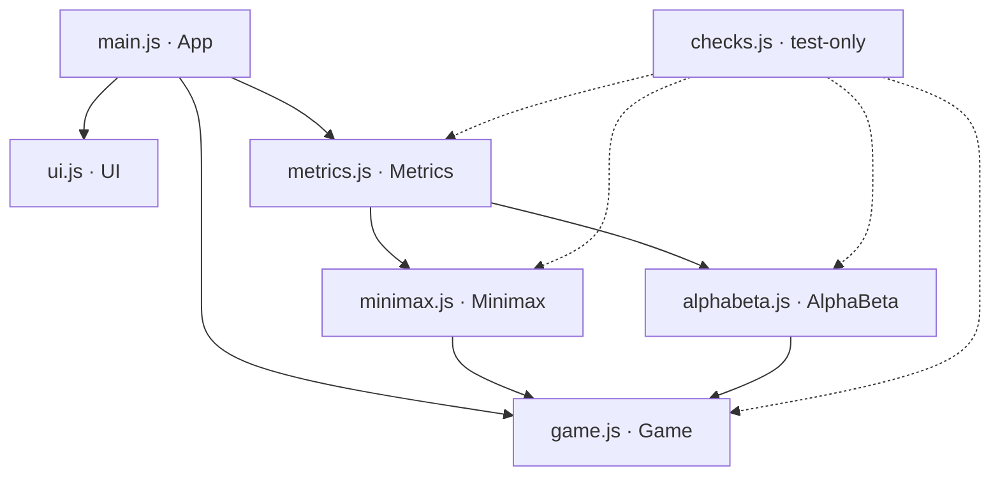

# Architecture Spine — Tic-Tac-Toe using Minimax and Alpha-Beta

The PRD and both addendums remain binding: the Node rule, scoring, Cell order, strict `>` tie-break, Move record shape, reference counts, and load order. This spine adds only the rules those documents leave open. All decisions were confirmed by the developer on 2026-10-15.

## Design Paradigm

**Functional core / imperative shell.**

| Layer | Files | May do | May not do |
| --- | --- | --- | --- |
| Core: rules | `game.js` (pure functions) | Board logic, scoring | DOM, timers, `performance` |
| Core: search | `minimax.js`, `alphabeta.js` | Recursion on a private Board copy, Node counting | DOM, timers, timing, any write to game state |
| Core: measurement | `metrics.js` | Timing with `performance.now()`, Match history, totals, formatting | DOM, timers, any write to game state |
| State | `game.js` (`Game` state holder) | Owns the live Board, game status and Scoreboard | DOM, timers |
| Shell: view | `ui.js` | DOM reads/writes, event listeners | Calling `Game`, `Metrics` or the searches |
| Shell: controller | `main.js` | Settings, turn sequencing, `requestAnimationFrame` + `setTimeout` | Board logic, search logic |

## Invariants & Rules



An arrow means "may call". Anything not drawn is forbidden. `ui.js` calls nothing; it receives data and reports user intents. No file in the graded app references `checks.js`.

### AD-1 — One global namespace per file `[ADOPTED]`

- **Binds:** all modules, NFR-3, the checks runner
- **Prevents:** Name clashes between classic scripts; files that only work in the browser or only in Node.
- **Rule:** Each file declares exactly one top-level `const` built with an IIFE: `Game`, `Minimax`, `AlphaBeta`, `Metrics`, `UI`, `App`. There are no other top-level bindings, no `import`/`export` and no `module.exports`. The core files (`game`, `minimax`, `alphabeta`, `metrics`) never mention `window`, `document` or `require`, so the same bytes load in the browser and through Node's `vm.runInThisContext`.

### AD-2 — `game.js` is the only owner of game state `[ADOPTED]`

- **Binds:** FR-1, FR-2, FR-10, FR-12, FR-13
- **Prevents:** A second Board copy in `ui.js` or `main.js` drifting from the real one; the Scoreboard being counted twice.
- **Rule:** The live state `{board, current, status, winner, winLine, generation}` and the Scoreboard `{x, o, draw}` exist only inside the `Game` closure. They change only through `Game.newGame(firstMark)` (`'X'` or `'O'`; `game.js` knows nothing about "human" or "AI"), `Game.play(cell)` and `Game.resetScores()`. Only `startGame()` in `main.js` calls `Game.newGame` (AD-10). `Game.snapshot()` returns a copy; callers never receive the live array. `Game.play` returns `false` and changes nothing for an illegal move. The Scoreboard is incremented inside the `Game.play` call that ends the Game, and nowhere else. `newGame` increments `generation`.

### AD-3 — Rules live once, in `game.js` `[ADOPTED]`

- **Binds:** FR-1, FR-2, FR-3, FR-4, NFR-5
- **Prevents:** Two win checks or two scoring functions, which would make the comparison unfair.
- **Rule:** These pure functions take a Board and never read the live state: `Game.legalMoves(board)` (Cell order 0→8), `Game.winner(board)` → `{mark, line} | null`, `Game.isFull(board)`, and `Game.score(board, me, depth)` → `10 − depth` / `depth − 10` / `0` / `null` when the Game is not over. Both searches call these and define no rule logic of their own.

### AD-4 — Search contract `[ADOPTED]`

- **Binds:** FR-3, FR-4, FR-5, FR-7, FR-11
- **Prevents:** Different signatures for the two searches; searches that assume the AI is always `O`, which would break Compare in Player vs Player when `X` is to move; a search corrupting the live Board; Node counts that drift from 549,946 / 20,866 (root counted zero or two times, `>` used for the cutoff, root alpha not raised, a draw score of `0` treated as "keep searching").
- **Rule:** `Minimax.search(board, me)` and `AlphaBeta.search(board, me)` both return `{bestMove, nodesVisited}`. `me` is the side to move at the root, and scores are from `me`'s point of view. Each search calls `board.slice()` once on entry, then makes and undoes moves on that private copy. The Node counter is a variable local to the `search` call. There is no module-level mutable state. Both searches have this shape:
  - `search` sets `nodes = 1`, which counts the root. If the root is already terminal, it returns `{bestMove: null, nodesVisited: 1}`.
  - The root loop scans `Game.legalMoves` in Cell order. It sends each child to `value(b, 1, toMove, …)` and replaces the best move only on a strictly greater score (`>`).
  - `value` does `nodes++` first. It ends the branch with `s = Game.score(b, me, depth)` when `s !== null`. The side to move is passed explicitly, never worked out from piece counts.
  - Alpha-Beta only: the root window is (−∞, +∞), and alpha is raised to the best score after each root child. Inside `value`, a maximizing node updates `v` and then `alpha = max(alpha, v)`, a minimizing node updates `beta`, and both then run `if (alpha >= beta) break`.

### AD-5 — Timing happens only in `metrics.js` `[ADOPTED]`

- **Binds:** FR-7, FR-8, FR-9, FR-11
- **Prevents:** Each algorithm timing itself in a slightly different way; timing code duplicated across both searches.
- **Rule:** The searches never call `performance.now()`. `Metrics` wraps each call and records the time in the `mmMs` and `abMs` fields of the shapes below. There is no other name for the time field.

### AD-6 — Metrics API: fixed shapes, one append path, read-only Compare

- **Binds:** FR-7, FR-8, FR-9, FR-11
- **Prevents:** Compare runs leaking into the totals; a second code path that appends Move records; the panel, the summary and Compare each using a different shape for the same measurement.
- **Rule:**
  - **`Measurement`** = `{mmMove, mmNodes, mmMs, abMove, abNodes, abMs}`.
  - **Move record** = `{turn, board, …Measurement}`, as defined in the PRD. `turn` is the 1-based AI-turn number in the current Game, assigned by `Metrics`. `board` is a copy of the Board before the AI moves.
  - `Metrics.runAiTurn(board, me, selected)` runs both searches and appends exactly one Move record. `selected` is `'minimax'` or `'alphabeta'`. It returns `{move, record}`, where `move` comes from the selected algorithm.
  - `Metrics.compare(board, me)` returns a `Measurement` and never appends.
  - `Metrics.summary()` returns `{aiTurns, mmTotal, abTotal, pctPruned, sameCount}`. Every value is derived from the history at read time; there are no running counters.
  - `Metrics.history()` and `summary()` return copies.
  - `Metrics.reset()` clears the history and is called only from `startGame()` (AD-10).
  - `Metrics.pctPruned(mm, ab)` → number. `Metrics.formatMs(ms)` → string with 2 decimal places, or `< 0.10 ms` when the delta is 0. `Metrics.formatPct(p)` → string with 2 decimal places. These are the only formatters.

### AD-7 — `main.js` runs the AI turn `[ADOPTED]`

- **Binds:** FR-7, FR-10, NFR-1
- **Prevents:** Timers in the core; an AI move landing on a new Game after Reset was pressed during the yield; "AI thinking…" stuck on screen for good; "AI thinking…" never painted before the search starts.
- **Rule:**

```mermaid
sequenceDiagram
  participant App as main.js
  participant UI as ui.js
  participant M as metrics.js
  participant G as game.js
  App->>App: aiThinking = true; gen = snapshot.generation
  App->>UI: render(view with "AI thinking…")
  App->>App: requestAnimationFrame → setTimeout(run, 0), keeping both handles
  App->>App: run: if generation ≠ gen → aiThinking = false, stop
  App->>M: runAiTurn(snapshot.board, snapshot.current, selected)
  M-->>App: {move, record}
  App->>G: play(move)
  App->>App: aiThinking = false
  App->>App: afterChange()
```

- While `aiThinking` is true, `main.js` ignores cell clicks and Compare.
- `startGame()` cancels any pending handles and sets `aiThinking = false`.
- Every exit from `run` sets `aiThinking = false`.
- A search is always given `snapshot.current` as `me`, never a literal mark. This applies to the AI turn and to Compare.

### AD-8 — The view is a pure render from intents `[ADOPTED]`

- **Binds:** FR-8, FR-10, FR-11, FR-12, FR-13
- **Prevents:** UI code that changes state, calls a search directly, or formats numbers itself (which would break the `< 0.10 ms` rule); no one deciding when Compare is disabled; an old Compare result left on screen.
- **Rule:** `UI.bind(handlers)` registers the callbacks `onCell(i)`, `onReset`, `onCompare`, `onMode(m)`, `onFirst(p)`, `onAlgo(a)` and `onResetScores`. `UI.render(view)` redraws from one view object built by `main.js`. Every string in it is already formatted with the `Metrics` formatters:

```text
view = {
  board[9], winLine|null, statusText,
  cellsEnabled, compareEnabled,
  settings {mode, first, algo},
  scoreboard {x, o, draw},
  lastMove   { mmMove, mmNodes, mmTime, abMove, abNodes, abTime, pctText, same } | null,
  summary    { mmTotal, abTotal, pctText, sameText } | null,
  compare    { same shape as lastMove } | null
}
```

  - `cellsEnabled` is false while the AI is thinking, once the Game is over, and in Player vs AI mode while O is to move.
  - `compareEnabled` is false while the AI is thinking and once the Game is over (FR-11).
  - Any change to the Game clears the Compare result.
  - `ui.js` stores nothing between renders except DOM references.

### AD-9 — Verification runner `[ADOPTED]`

- **Binds:** PRD §7 gates, SM-2, SM-3
- **Prevents:** A gate that passes in one environment but fails in the other; test code leaking into the graded page; testing the same-move claim against the wrong set of Boards.
- **Rule:**
  - `checks.js` loads `game.js`, `minimax.js`, `alphabeta.js` and `metrics.js` in that order. In Node it uses `vm.runInThisContext` (`node checks.js`). In the browser, a separate `checks.html` loads the same four scripts and then `checks.js`. `index.html` never loads it.
  - It checks:
    - the 8 winning lines and the draw case;
    - 549,946 Nodes and cell 0 for Minimax;
    - 20,866 Nodes and cell 0 for Alpha-Beta;
    - 0 mismatches over the AI-turn set.
  - The **AI-turn set** is every distinct Board reachable by legal play where the Game is not over and O is to move. It is built once for X moving first and once for O moving first, and the two counts are added. The script asserts that the total is 4,520 before checking for mismatches. If the count differs, fix the definition, not the searches.
  - Known-wrong Alpha-Beta counts used for diagnosis: 125,500 means the cutoff uses `>` instead of `>=`; 34,203 means root alpha is not raised.
  - Running the same file in both environments:
    - `checks.js` is wrapped in an IIFE and refers to the modules by their bare names (`Game`, not `window.Game` or `globalThis.Game`, which are `undefined` for a `const`).
    - The Node loader runs only when `typeof window === 'undefined'`. It reads each file with `require('fs')` and a path built from `__dirname`, and calls `vm.runInThisContext(src, { filename: path })`.
    - The file has no `import`/`export`, and the repo has no `package.json` with `"type": "module"`.

### AD-10 — One path to start a Game, one path to schedule the AI

- **Binds:** FR-7, FR-9, FR-10, FR-12, FR-13
- **Prevents:** A handler that forgets to start the AI (for example, when switching to "AI first" or from Player vs Player to Player vs AI); a new Game that keeps the previous Game's Match history.
- **Rule:**
  - `startGame()` in `main.js` is the only caller of `Game.newGame` and `Metrics.reset`. It also clears the Compare result and pending AI handles.
  - Reset, changing the mode and changing who moves first all call `startGame()`. Changing the algorithm does not; it takes effect on the next AI turn.
  - The first mover is `'X'` in Player vs Player mode. In Player vs AI mode it is `'X'` or `'O'`, depending on who moves first.
  - `afterChange()` is the only function that schedules an AI turn. It renders, then starts AD-7 when all of these hold: the mode is Player vs AI, the Game is still playing, O is to move, and the AI is not already thinking. It runs after `startGame()`, after every successful human move, and after every AI move.

### AD-11 — Boot

- **Binds:** NFR-2, NFR-3
- **Prevents:** `ui.js` keeping null DOM references because the scripts ran before the page body existed.
- **Rule:** `index.html` loads the six scripts at the end of `<body>`, in the PRD order. No file touches the DOM while it is loading. One inline call, `App.start()`, runs `UI.bind(…)` and then `startGame()`.

## Consistency Conventions

| Concern | Convention |
| --- | --- |
| Marks and players | `'X'`, `'O'`, `null` for an empty cell. The human is `X` and the AI is `O`. `current` is stored in the state, not worked out from piece counts. |
| Cells | An integer from 0 to 8, row-major. A winning line is `[a, b, c]` in ascending order. |
| Settings values | mode: `'pvai'` / `'pvp'`; first: `'human'` / `'ai'`; algorithm: `'minimax'` / `'alphabeta'`. |
| Game status | `'playing'` / `'won'` / `'draw'`. |
| Naming | Files are lowercase. Namespaces are PascalCase. Functions are camelCase verbs. |
| Errors | Illegal input returns `false` or `null` and never throws. No `try/catch` in the core. |
| Logging | `console.log` appears only in `checks.js`. |

## Stack

| Name | Version |
| --- | --- |
| HTML / CSS / JavaScript (classic scripts, ES2015+) | Evergreen Chrome and Firefox |
| Node.js (only to run `checks.js`) | 24.x LTS (v24.14.1 installed) |

## Structural Seed

```text
Tic-Tac-Toe/
  index.html     # the graded app; loads the 6 scripts in order
  style.css
  game.js  minimax.js  alphabeta.js  metrics.js  ui.js  main.js
  checks.js      # gate runner (node checks.js)
  checks.html    # loads the 4 core scripts + checks.js for the browser console
```

The tree is flat, with no `js/` folder, so every file is one click away during the viva.

## Capability → Architecture Map

| Capability | Lives in | Governed by |
| --- | --- | --- |
| FR-1, FR-2 rules | `game.js` | AD-2, AD-3 |
| FR-3, FR-4, FR-5 searches | `minimax.js`, `alphabeta.js` | AD-3, AD-4 |
| FR-6 never loses | searches + `main.js` | AD-4, AD-7 |
| FR-7, FR-9 Shadow run, totals | `metrics.js` | AD-5, AD-6 |
| FR-8 panel | `metrics.js` formatters → `ui.js` | AD-6, AD-8 |
| FR-10 turn flow | `main.js` | AD-7, AD-10 |
| FR-11 Compare | `main.js` → `Metrics.compare` | AD-4, AD-6, AD-8 |
| FR-12, FR-13 PvP, Scoreboard | `game.js`, `ui.js` | AD-2, AD-8, AD-10 |
| NFR-2, NFR-3 zero setup | `index.html` | AD-1, AD-11 |
| NFR-4, NFR-5 | all | Paradigm, AD-3 |

## Deferred

- **Hosting / deployment:** none. The app runs from `file://` only (NFR-2). Revisit only if a hosted demo is wanted.
- **Persistence:** none, by design. The Scoreboard lasts only for the Session.
- **CSS structure and visual design, accessibility beyond basic button semantics:** P2 polish. Decide while building `ui.js`.
- **Test framework:** excluded by the PRD. `checks.js` is the whole test strategy.
- **Performance tuning:** none, because SM-C1 forbids search optimizations. The worst case, an AI-first empty Board with both searches, takes about 0.23 s in Node. In Chrome the first search after page load took 0.39–0.60 s, which is under NFR-1's 1 s with about 2× headroom. Revisit only if Firefox measures above 1 s.
- **Timer resolution:** Node counts are the primary evidence and time is secondary (brief addendum). Browsers limit `performance.now()` precision: about 100 µs for a `file://` page in Chrome, and possibly 1–2 ms in Firefox. A `< 0.10 ms` reading is therefore accepted as it is shown. Check it in Firefox during SM-5.
