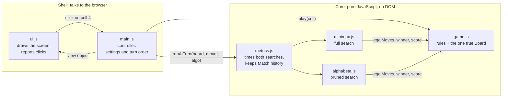

# Tic-Tac-Toe: How the Pieces Fit

**In one sentence:** a pure, testable core (rules, two searches, measurement) sits inside a thin shell (controller and view). Only the shell touches the screen or the clock's event loop.

## The six modules

| Module | Its one job | What it never does |
| --- | --- | --- |
| `game.js` | Holds the Board and the Scoreboard. Knows the rules: legal moves, the 8 winning lines, scoring. | Touch the screen |
| `minimax.js` | Searches every move to the end and counts Nodes. | Change the real Board, or time itself |
| `alphabeta.js` | Runs the same search but skips branches that cannot change the answer. | Use different rules from Minimax |
| `metrics.js` | Times both searches, stores one Move record per AI turn, adds up totals. | Draw anything |
| `ui.js` | Draws whatever it is given and passes clicks back to `main.js`. | Make decisions |
| `main.js` | Decides whose turn it is and runs the AI turn. | Contain game rules or search code |

## What happens on one AI turn

1. **main.js** shows "AI thinking…" and waits one frame (`requestAnimationFrame` then `setTimeout`) so the browser paints that message before the search blocks it.
2. **main.js** gives a copy of the Board to **metrics.js**.
3. **metrics.js** runs **both** searches on that copy and times each one:
   - Minimax → cell 0, 549,946 Nodes
   - Alpha-Beta → cell 0, 20,866 Nodes
4. **metrics.js** saves one Move record and returns the move of the algorithm the user selected.
5. **main.js** tells **game.js** to play that move. **game.js** checks for a win and updates the Scoreboard.
6. **main.js** sends the new state to **ui.js**, which redraws the Board, the metrics panel and the "same move ✓" line.

The numbers in step 3 are for an empty Board.

## Three points the design makes for you

- **The comparison is fair.** Both searches call the *same* rule and scoring functions in `game.js`, scan cells 0→8, and keep the first best move. So they must agree, and on every AI turn the app shows that they do.
- **Measurement cannot change the game.** Each search works on its own copy of the Board, and Compare only reads. The Board changes in one place only: `game.js`.
- **The counter is trustworthy.** The core has no browser code, so `node checks.js` can run the exact same files and confirm the counts: 549,946 Nodes for Minimax and 20,866 for Alpha-Beta from the empty Board, and 0 disagreements over all 4,520 positions where it is the AI's turn.
